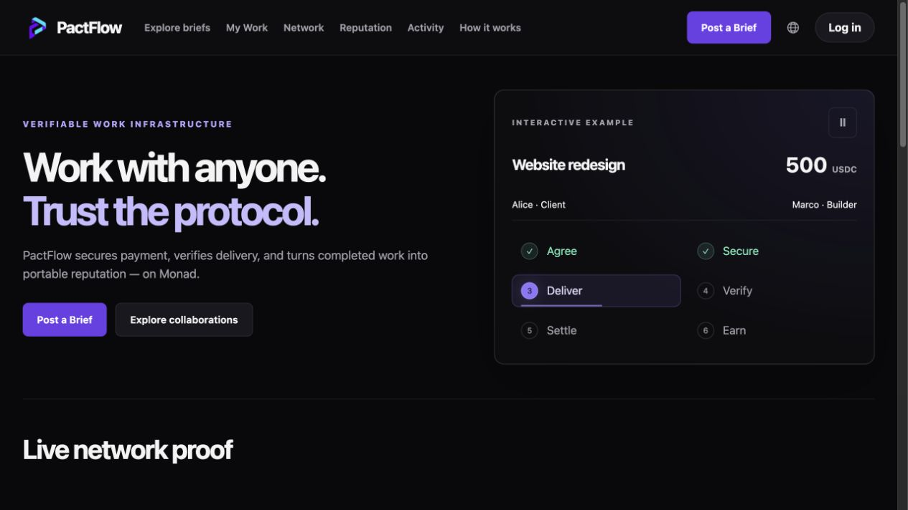

<p align="center"></p>

# PactFlow

**Secure milestone payments. Verify delivery. Build a portable work history.**

PactFlow is a collaboration platform on Monad that connects clients and contributors through partner discovery, milestone agreements, escrow, delivery review, and settlement.

[Live product](https://pactflow-lovat.vercel.app/) · [Product demo](https://youtu.be/zcTFd6u4eO8) · [Pitch video](https://youtu.be/NLe_BA39Z2k) · [Public work receipt](https://pactflow-lovat.vercel.app/p/fe611fdc-2b9f-4a88-8693-2f4899ac8660)



## Why PactFlow

Clients want confidence that delivered work meets their requirements. Contributors want confidence that they will get paid. Conversations, files, payments, and reputation often live in separate tools, leaving both sides without a shared record of what was agreed and completed.

PactFlow brings that workflow together. Clients secure the budget in a smart contract; contributors submit evidence against agreed milestones; accepted work releases payment and becomes part of a verifiable work history. Our initial use case is Monad ecosystem teams commissioning scoped development, design, and documentation tasks.

## How it works

1. **Find a partner.** Publish a work brief, receive applications, and choose a contributor. Already know your partner? Create an agreement directly.
2. **Agree on the work.** Confirm deliverables, milestone amounts, deadlines, acceptance rules, revision limits, and participant wallets before funding.
3. **Secure payment.** The client locks funds in the agreement's escrow contract, and the contributor accepts the agreement.
4. **Deliver and review.** Submit evidence, inspect the result, and request specific revisions when needed. Submission history is retained.
5. **Settle and build history.** Accepted milestones pay the contributor directly. Completed work contributes to a Work Passport and activity history. Both participants can approve a public work receipt.

A work brief helps people find each other. A Pact records the terms they have both accepted and enforces the payment workflow.

## Try it as a judge

- **Start with the [product demo](https://youtu.be/zcTFd6u4eO8)** for the client and contributor workflow, including delivery, revision, and settlement.
- **Open the [public receipt](https://pactflow-lovat.vercel.app/p/fe611fdc-2b9f-4a88-8693-2f4899ac8660)** to inspect completed work and follow its settlement transaction. No login or wallet is required to view it.
- **Explore the [live app](https://pactflow-lovat.vercel.app/).** First-time visitors see English; Chinese is available from the language menu. An explicitly chosen language is remembered.
- **To perform wallet actions,** connect an EVM wallet on Monad Testnet (chain ID `10143`) and sign the authentication challenge. Account registration is optional; guest wallet access is supported. A complete collaboration uses separate client and contributor wallets, test MON for gas, and the deployed test settlement token listed below.

The verified public acceptance path is client review: the contributor submits delivery, and the client either requests a revision or approves settlement. Publishing a receipt is a separate, optional action after completion; both parties must approve exactly the same public content.

## Real Monad Testnet execution

The public product is connected to deployed contracts and a persistent backend. A completed collaboration has released **1 test USDC** and produced a public receipt approved by both participants.

| Evidence               | Link                                                                                                                   |
| ---------------------- | ---------------------------------------------------------------------------------------------------------------------- |
| Public work receipt    | [View the completed collaboration](https://pactflow-lovat.vercel.app/p/fe611fdc-2b9f-4a88-8693-2f4899ac8660)           |
| Agreement contract     | [`0xbd83…4ce1`](https://testnet.monadvision.com/address/0xbd83dbde3e718f7d7b1b2788f7d1b9d63fe84ce1)                    |
| Settlement transaction | [`0x9cb4…6927`](https://testnet.monadvision.com/tx/0x9cb4d13bbb8dee8982bc72bfe61a12acc16e6f650d6b0e2c541a3bc86e9f6927) |

Current deployment: **Monad Testnet · chain ID 10143 · protocol V2**.

| Contract                   | Address                                                                                                                            |
| -------------------------- | ---------------------------------------------------------------------------------------------------------------------------------- |
| PactFactoryV2              | [`0xbce5397fc2ec37769d664961405707fec1c6da69`](https://testnet.monadvision.com/address/0xbce5397fc2ec37769d664961405707fec1c6da69) |
| VerifierRegistryV2         | [`0x2038b44c4b05bc2eb01f031f2f91e02baa1b9a18`](https://testnet.monadvision.com/address/0x2038b44c4b05bc2eb01f031f2f91e02baa1b9a18) |
| ReputationRegistryV2       | [`0x3dd792ca984322e84864ec9fb47e237f51707a64`](https://testnet.monadvision.com/address/0x3dd792ca984322e84864ec9fb47e237f51707a64) |
| Test USDC settlement token | [`0x534b2f3A21130d7a60830c2Df862319e593943A3`](https://testnet.monadvision.com/address/0x534b2f3A21130d7a60830c2Df862319e593943A3) |

The [deployment record](packages/chain/src/addresses/monad-testnet-v2.json) includes deployment transactions, blocks, and code hashes. New agreements use V2 for revisions; historical V1 contracts and records are retained. Protocol versions describe contract compatibility; the product name is **PactFlow**.

## Payments, verification, and privacy

- **Escrow pays the contributor.** For manual acceptance, the client signs the settlement transaction and the contract transfers the milestone payment directly. The platform dispute resolution wallet arbitrates disputes; it does not custody the budget or sign every normal payout.
- **Funded terms are locked.** Participant roles and contract state determine available actions. V2 verification signatures bind to the current submission and prevent stale attestations and repeated settlement.
- **Delivery can improve.** Agreements default to an initial submission plus two revisions; limits are confirmed before funding. Recoverable verification service errors do not count as failed delivery attempts.
- **Evidence is private by default.** Participant-authorized evidence and reports stay behind access checks. Public receipts expose only the content both parties approved; private evidence is not automatically published on-chain.
- **History comes from actual execution.** Work history and metrics use indexed contract events and verification records. Missing data is shown as unavailable rather than replaced with invented scores.

The live manual review workflow works independently of optional integrations. AI review requires a configured model and API key; Google identity requires OAuth configuration; private file uploads require object storage and scanning. GitHub/CI checks use pinned commits and actual check results. External verifier adapters require registration and authentication. Unconfigured capabilities are reported as unavailable, and service failures never produce a passing attestation.

## Architecture

| Component              | Implementation                                                               | Source                                                         |
| ---------------------- | ---------------------------------------------------------------------------- | -------------------------------------------------------------- |
| Web application        | Next.js, React, wallet interaction, English/Chinese UI                       | [apps/web](apps/web)                                           |
| API                    | Fastify, wallet authentication, object permissions, submissions and receipts | [apps/api](apps/api)                                           |
| Verification           | Evidence normalization, checks, review policies, reports and attestations    | [apps/verifier](apps/verifier)                                 |
| Data                   | Drizzle, PostgreSQL, append-only submission and verification history         | [packages/db](packages/db)                                     |
| Contracts              | Solidity, Foundry, escrow and verifier/reputation registries                 | [packages/contracts](packages/contracts)                       |
| SDK and chain bindings | TypeScript, viem, version-aware contract interaction                         | [packages/sdk](packages/sdk), [packages/chain](packages/chain) |
| Read model             | Envio handlers and persistent event synchronization                          | [indexer](indexer)                                             |

The public web app runs on **Vercel**. Production browsers call the website's own `/api/v1` paths; Vercel forwards those requests to the configured HTTPS backend. Its independent backend runs on **Aliyun with Docker Compose**, PostgreSQL, Redis, HTTPS, and a durable verification worker. This deployment explicitly uses bounded Monad RPC event indexing. The full deployment supports Envio GraphQL and a separate worker; production indexing does not silently change sources on failure.

See the [current lightweight deployment](deploy/LIGHTWEIGHT.md) and [full Linux deployment guide](deploy/README.md) for configuration, migrations, health checks, backups, and recovery.

## Run locally

Prerequisites: **Node.js 24**, **pnpm 11.25.0** through Corepack, and **Monad Foundry** (`forge` and `anvil`).

```sh
git clone https://github.com/0xjonathon/pactflow.git
cd pactflow
corepack pnpm install --frozen-lockfile
sh scripts/bootstrap-foundry.sh
forge build --root packages/contracts
```

Start the isolated local chain in a separate terminal:

```sh
anvil --host 127.0.0.1 --port 8547 --chain-id 10143 --block-time 1
```

Then deploy local contracts and start the API and web app from the repository root:

```sh
corepack pnpm local:deploy
corepack pnpm local:services
```

Open [localhost:3011](http://localhost:3011). The helper generates local test wallets and tokens, configures the services, and creates an isolated PGlite database. This path does not require a PostgreSQL server or broadcast public-chain transactions. Generated `.local` files contain test private keys: keep them private and never reuse those keys on public networks.

## Validation

Generate indexer types before running workspace checks:

```sh
corepack pnpm --filter @pactflow/indexer codegen
corepack pnpm typecheck
corepack pnpm lint
corepack pnpm format:check
corepack pnpm test
corepack pnpm test:contracts
```

With Anvil and the local services running, install the browser and run the two-party workflow tests:

```sh
corepack pnpm --filter @pactflow/web exec playwright install chromium
corepack pnpm test:e2e:local
```

For a production build, stop the local Next.js development server before running `corepack pnpm build`.

The [CI workflow](.github/workflows/ci.yml) runs type, translation, lint, formatting, unit, integration, contract, build, and local-chain browser checks. PostgreSQL/Redis integration tests require dedicated loopback services configured through `TEST_DATABASE_URL` and `TEST_REDIS_URL`; CI supplies them. Skipped integration tests are not passes. CI does not broadcast transactions on public chains.

Recorded local results are available in [validation evidence](qa/evidence/VALIDATION.md). Public-chain execution can be inspected through the receipt and explorer links above. The contracts have not undergone an independent security audit.

[Download the project logo](assets/brand/pactflow-logo.png) · [Legacy V1 documentation](docs/README-V1.md)
